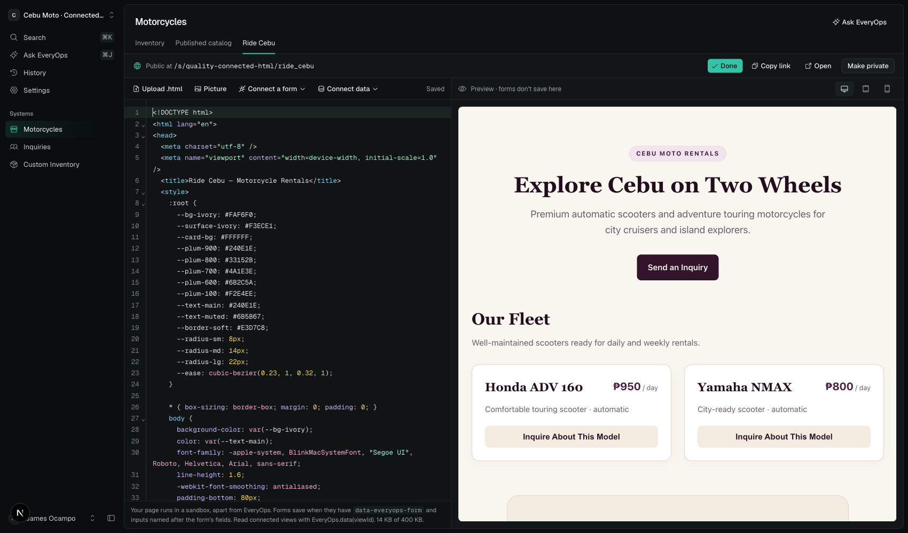
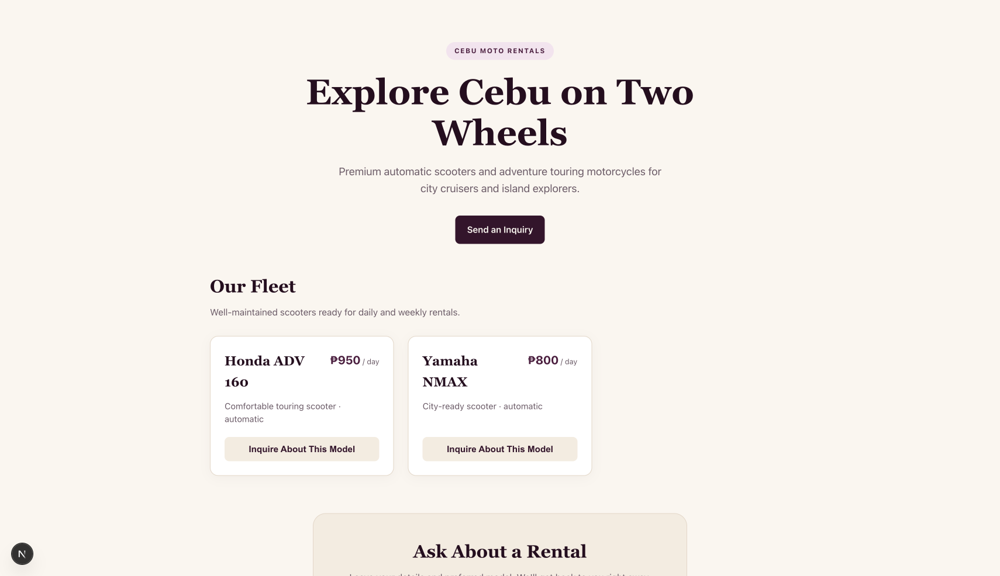
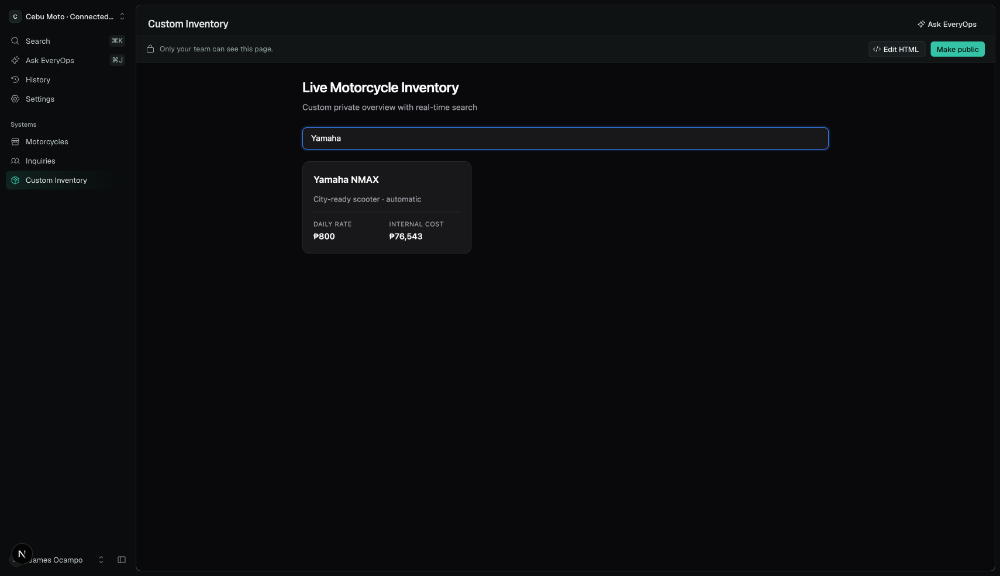
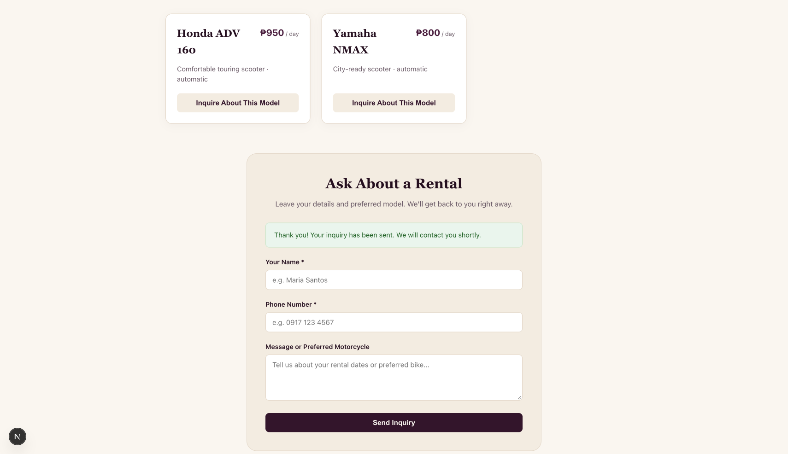
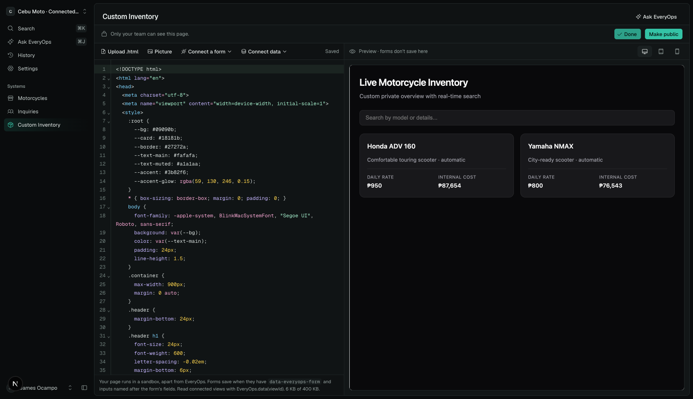
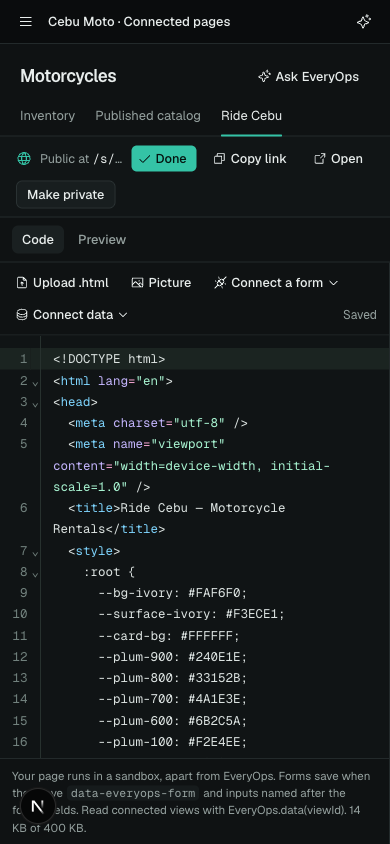
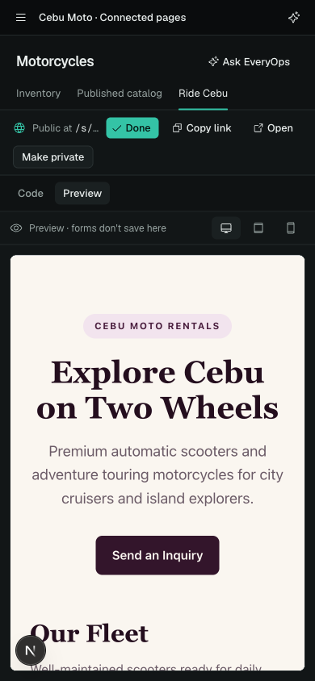

# Connected custom HTML pages

Custom page requests now favor complete HTML/CSS/JavaScript. The component library supplies design and data references; it does not constrain the custom page's visual layout. Ordinary table/record changes still use the existing workspace engine. Generated pages remain undoable changes, and only managers can save custom HTML.

The editor uses CodeMirror 6 with HTML, embedded CSS and JavaScript highlighting, line numbers, folding, search, bracket matching and undo. Autosave, file/picture insertion and the responsive live preview are retained. Tab moves focus rather than trapping keyboard users. Connect data inserts an editable bridge example, listing only sources available to that page.

## Runtime contract

`await EveryOps.data(viewId)` returns current view results. Check `ok` before using data; failures include `message`.

| Context | Allowed sources | Result |
| --- | --- | --- |
| Public HTML, including signed-in editor preview | Published layout and landing views | Existing public resolver's computed layout sections or resolved blocks; source HTML excluded |
| Private HTML inside the authenticated workspace | Table views, plus published layout/landing sources | Table columns and formatted cells using that view's selected fields, filter and sort; `total` and `truncated`, capped at 500 rows |

Public data is served by `GET /api/public/:workspace/:view/data` with `no-store` and a read rate limit. It never falls back to authenticated private records. The private table reader is provided only by the authenticated workspace wrapper; page JavaScript cannot select a workspace or change its access mode. Existing public safety checks still restrict fields and people data.

Forms use the existing public-form bridge: `EveryOps.form`, `submit`, `slots`, `days`, `quote`, `upload`, or `data-everyops-form` with inputs named by actual field IDs. Server-side form validation, booking conflicts and pricing remain authoritative. Normal workspace display can submit to those same public forms; editor and community previews cannot save/upload. Private form writes and arbitrary record updates/deletes are not added.

The bridge waits for a parent readiness handshake before sending queued requests. Only handshakes repeat; writes are sent once. Requests expire after 30 seconds, and expired queued submissions are never sent later. The iframe retains its opaque origin, without `allow-same-origin`.

Both setup and assistant edits receive the shared bridge contract. The assistant response schema preserves publication flags on custom HTML/layout pages. Literal form/data references are checked against the resulting blueprint before offering a plan. Setup preserves an explicitly coded public website and its landing data sources instead of replacing them with the standard site.

## Verification, 2026-10-15

Local isolated PostgreSQL, synthetic Cebu Moto workspace, real Vertex Gemini 3.7 Flash calls. No production deployment or customer records used.

- Real assistant requests: custom public catalog/inquiry page (62.8 seconds); private searchable inventory (54.1 seconds); bespoke customization without saying HTML (42.3 seconds). All returned HTML plans. Both public cases retained `public:true`. Full requests and returned plans are in [the evaluation artifact](quality/connected-html-eval.json).
- The initial public plan omitted publication despite claiming it; this was caught, the schema fixed, and the request rerun. Browser testing separately caught and fixed a first-load bridge race.
- Browser: generated public page renders Honda ADV 160 at ₱950 and Yamaha NMAX at ₱800 from the live published catalog. Private search filters to Yamaha and displays internal costs only inside the workspace.
- A form submitted in the actual generated iframe saved exactly one inquiry: `inquiry_49d0a86187`, synthetic name `Local QA Rider`, message referencing Honda ADV 160. Verified through authenticated workspace read-back.
- Public endpoint: catalog 200; private stock/inquiries and unknown views 404; form-as-data rejected. Private costs absent from public catalog. Public iframe and signed-in public preview both denied `EveryOps.data("stock")`. Editor preview rejected submission.
- Code editor: visible line gutter and colored syntax; keyboard edit persisted to the API, undo persisted the original HTML. Mobile Code/Preview switching verified at 390×844.
- `pnpm typecheck`, `pnpm lint`, `pnpm test --maxWorkers=2` (387 tests), `pnpm build`. Test workers were limited after unrelated engine tests hit timeouts while another local workload saturated the machine; no test timeouts were increased.

Literal reference validation is not a JavaScript compiler and cannot prove arbitrary generated scripts correct. Dynamic IDs are checked at runtime. These three real requests are focused evidence, not a general accuracy benchmark. Setup preservation is unit-tested; a complete fresh AI setup was not rerun for this change. Data refreshes when the page calls the bridge; this does not introduce a subscription API.

## Screenshots

Actual browser captures from the generated pages, not mockups.

