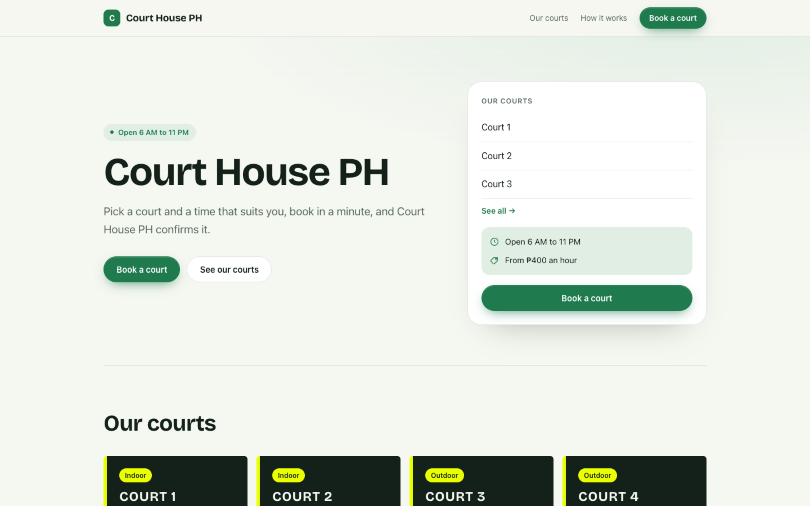
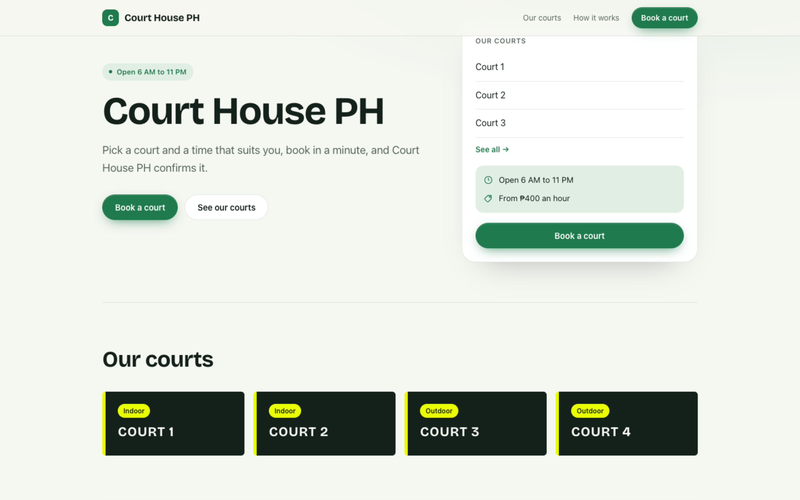
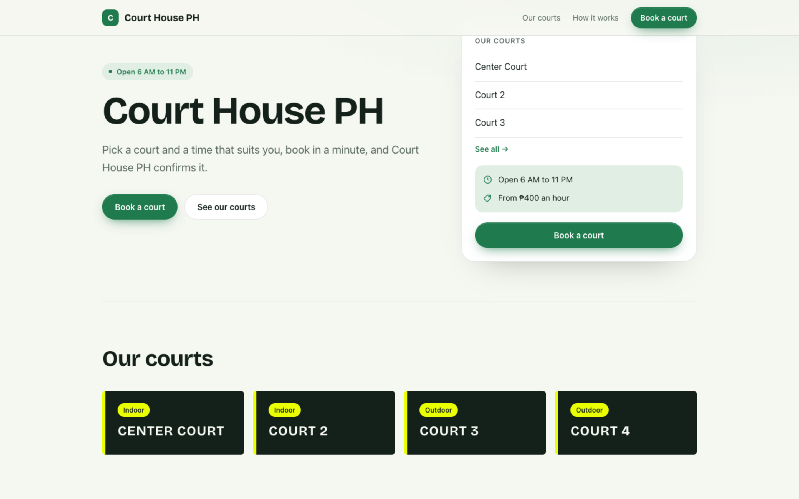
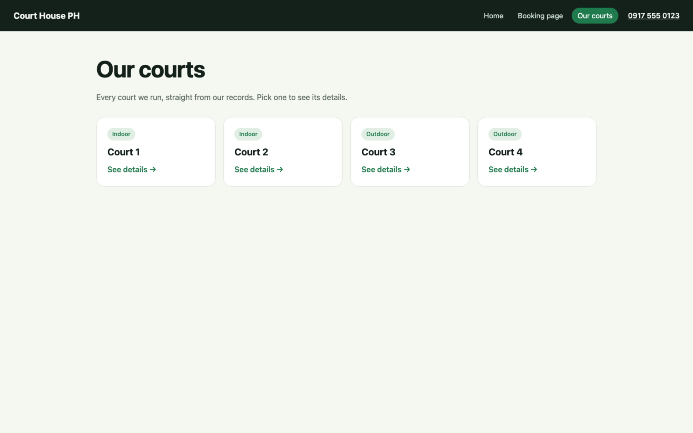
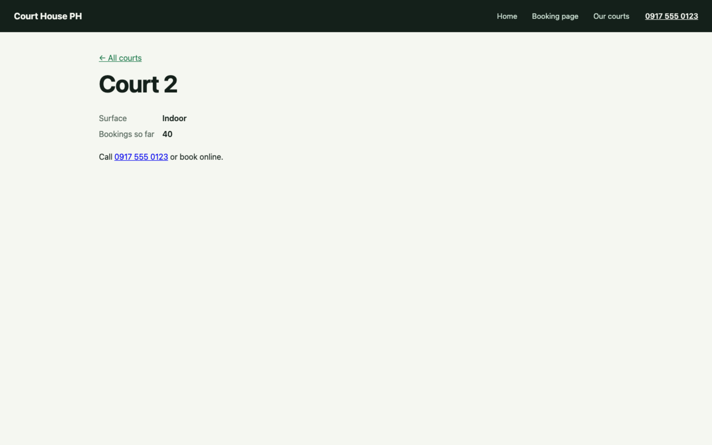
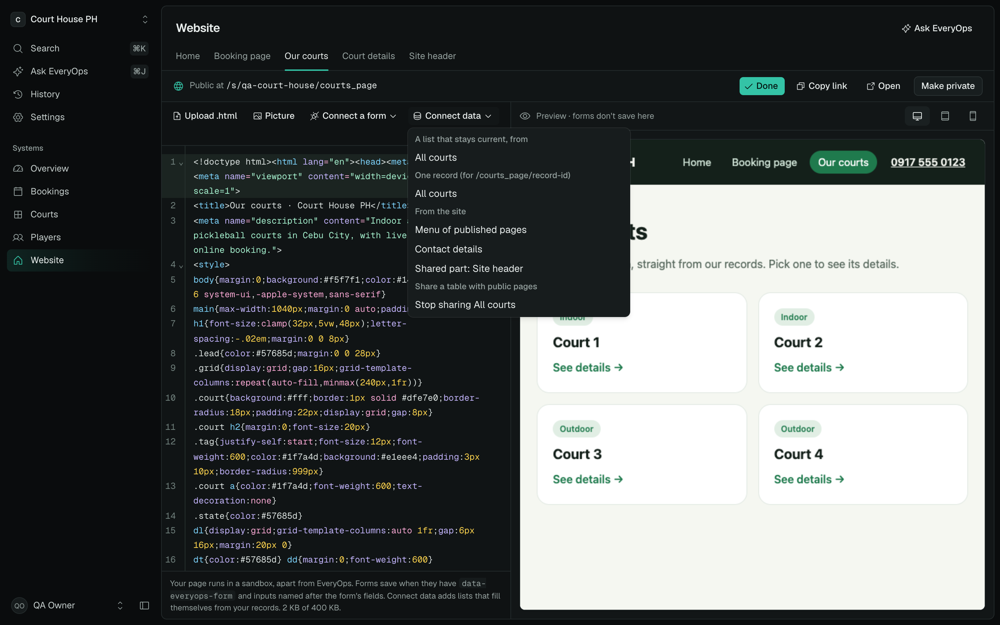
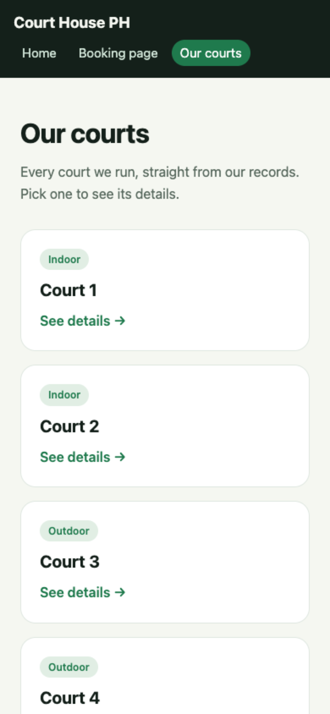

# Dynamic custom HTML pages

Custom HTML pages used to show workspace data only when their own JavaScript fetched it and drew it. Setup's website redrew five fixed sections with its own markup, so a restyled card lost its design on the next view, and everything else on the page was text frozen at creation. Pages now mark where data goes in plain HTML, and the bridge fills it in from current results every time the page is shown.

## Bindings

```html
<div class="grid">
  <p data-everyops-state="loading">Loading…</p>
  <p data-everyops-state="empty" hidden>None yet.</p>
  <p data-everyops-state="error" hidden></p>
  <template data-everyops-each="courts_table" data-everyops-refresh="30">
    <article>
      <span data-everyops-if="surface" data-field="surface"></span>
      <h2 data-field="@title"></h2>
      <a data-href="/s/__everyops_site__/court_detail/{@id}">See details</a>
    </article>
  </template>
</div>
```

| Markup | What it does |
| --- | --- |
| `<template data-everyops-each="SOURCE">` | Repeats its content per row. `data-everyops-block` picks a part of a landing/layout source, `-limit` caps rows, `-skip="@title="` skips rows, `-refresh="30"` re-reads (15 s minimum, paused while the tab is hidden). |
| `data-field` / `data-everyops-text` | A value as text: a field id or name, or a role (`@id @title @image @about @price @rows @tags @1 @2…`). |
| `data-everyops-if` / `-unless` | Keeps an element only when a value is filled, or equals one (`@kind=hours`). |
| `{key}` in an attribute | Replaced inside rows; outside rows add `data-everyops-bind`. `data-src`/`data-href` become `src`/`href`. |
| `data-everyops-state` | Siblings shown while loading, empty or failed. `data-everyops-hide-empty` on an ancestor hides a whole section with nothing to show. |
| `<template data-everyops-each="@rows">` | A row's label/value details (`@name`, `@text`); `@tags` for its short labels. |
| `data-everyops-record="SOURCE"` | Fills one row: the record id in `/s/[workspace]/[page]/[record]` (or `data-everyops-id`). Missing records show the empty state. |
| `site.*`, `route.*` | `site.name/phone/email/address/hours/home/book/bookLabel`, `route.id`, `route.query.NAME`. `site.pages` is a list for menus (`name`, `href`, `current`); detail pages are left out. |
| `<div data-everyops-include="PAGE">` | Replaced on the server by another HTML page's styles and body (usually a team-only header or footer), once. |

Values only ever become text or attribute values, never HTML; `javascript:`, `vbscript:` and `data:text` URLs become `#`. Page scripts can still use `EveryOps.data/items/record/site/route/watch`, call `EveryOps.bind()` after adding bound markup, and listen for `everyops:bound`.

The frame does no data shaping. The page around it answers `items` and `record` with `itemsOf` (`src/lib/public/bindings.ts`), which turns a table, landing, layout or the page's own sections into the same rows, so bindings work the same on every source.

## Sources

- Published layout and landing pages, as before.
- Table views shared as public data (`TableView.publicData`). Managers share one from Connect data, or Ask EveryOps uses `update_view` with `public: true` on the table; it never becomes a page of the site. `sharedTableProblems` refuses record types about people and record types whose rows belong to someone (a booking's player, an order's customer), and `sharedFields` drops personal fields and costs, margins, suppliers and salaries. Validation applies the same rule. Rows keep their record ids so lists can link to detail pages.
- Private HTML pages still read any table view inside the signed-in workspace.
- `page`: a website setup made reads its own sections (offer, payments, faq, hero facts, contact).

## Setup's website

Its offer cards, payment methods, FAQs, hero picks and facts, contact details, brand name and footer are now bindings. An owner can restyle the markup inside a template freely; only the values change. Pages made before bindings keep their `<!--everyops:live id-->` parts, still redrawn on the server.

## Search and link previews

A custom page draws inside its frame, so the public route now takes its title, description and `og:image` from the page's own tags (description falls back to its first real paragraph) and renders a `<noscript>` copy of its headings, paragraphs and the titles its bindings list from shared tables and its own sections. Loading/empty placeholders are left out.

## Verification, 2026-10-15

Local isolated PostgreSQL 17 on port 5546, synthetic workspace built by `scripts/qa-dynamic-pages.mts` (court-bookings sample, setup's website, a shared courts table, a team-only header included by two public pages, a courts list and a court detail page). Production build served with `next start`; Chromium through Playwright. No production data or deployment.

- Owner restyled the offer cards (dark cards, accent edge, new class). Renaming Court 1 to Center Court in the records, with no page edit, showed Center Court in all four restyled cards and in the hero picks; the four `owner-card` elements were still there.
- Courts list read the shared table; the included header's menu listed Home, Booking page and Our courts with the current page marked, left out the detail page, and linked the phone as `tel:0917 555 0123`. Clicking a court opened `/s/qa-court-house/court_detail/court_2` showing Court 2, Indoor, 40 bookings.
- Data endpoint: shared courts 200 with name, surface and bookings only (no player or phone text); players 404; bookings 404; unknown view 404. The court sample's bookings are refused for sharing (each belongs to a player).
- Metadata: description and `og:title` from the page; `<noscript>` lists Court 1–4 and no loading text. Private header page renders not found.
- Editor: Connect data lists the list and single-record sources, the site menu, contact details, the shared header, and Stop sharing All courts. No page errors in any run.
- `pnpm typecheck`, `pnpm lint`, `pnpm test` (424 tests in 72 files), `pnpm build`. `bindings-dom.test.ts` runs the real bridge in happy-dom: rows, nested details, limits, skip, states, hidden empty sections, site values, the page menu, script-URL refusal, text-only values and single records.

Not covered: a fresh AI setup run and real Gemini assistant requests using the new contract (the prompt changed; the plan checks are unit-tested), and a deployed environment.

## Screenshots









