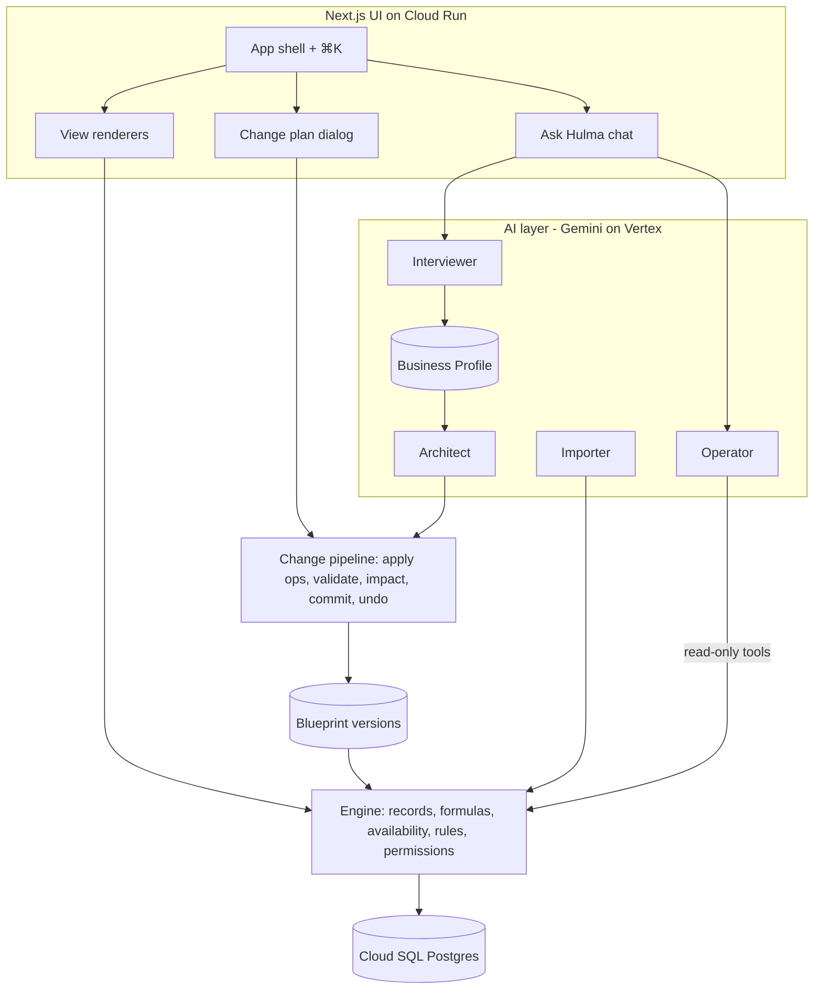

# Hulma — Design Spec

Date: 2026-10-13 · Status: written, awaiting James's review · Competition: Google Cloud AI Builder Cup 2026 (submission closes 2026-10-18)

Companion documents: ../../../../AI Builder Cup 2026.md (event facts), ../../../../Concept - Self-Configuring Business Workspace.md (concept), ../../../../UI Mockups/v2-minimal/ (visual reference only).

## 1. Shared understanding

**What James said**

- Hulma is one platform. A business never gets a separate app. The AI shapes systems *inside that business's dashboard*.
- The AI works out what data to save, how to display it, what the line of business is and what the user wants. It asks follow-up questions until its information is complete.
- It must be able to create: booking systems (rental, pickleball), social media management, finance/sales trackers, HRIS, and POS.
- The system composes tables, kanban, lists, charts and interactive components.
- UI/UX: inspired by Linear (and Notion). Compact, minimal, clean, direct. The generated mockups are inspiration, not the spec.
- Track: Future of Work & Enterprise Productivity.

**What this spec assumes (correct any of these)**

- A1. Team of 2–4 with James as tech lead. The plan assigns work lanes so people can work in parallel.
- A2. Hackathon-grade auth: seeded users per workspace with an Owner/Staff switcher. No public sign-up.
- A3. The AI never writes or executes code. It only edits validated configuration.
- A4. Region asia-southeast1 (Singapore). Timezone Asia/Manila. Currency PHP.
- A5. "Done" means the six demo flows in §12 work on the deployed Cloud Run URL with live Gemini, and every flow also has a recorded fixture fallback.

**Success criteria**

1. From an empty workspace, the setup chat produces a working booking system for a pickleball venue after at most 3 question rounds.
2. The same engine produces all five system types. Each is generated by the Architect (not hand-written) and passes validation.
3. A plain-language change ("peak 17:00–22:00 is ₱520, members get 10% off") produces a change plan with an impact list, applies in one transaction, and undoes cleanly.
4. A photo of a price list produces a POS with the products imported.
5. Asking "which bookings are unpaid today?" returns a correct answer that links to the records.
6. Deployed on Cloud Run, using Gemini on Vertex AI.

## 2. Approaches considered

| Approach | How it works | Verdict |
|---|---|---|
| A. Generate code per business | Gemini writes app code for each workspace and the platform deploys it | Rejected. Contradicts "inside our software", is unsafe, slow and unreliable in a live demo |
| B. Prebuilt modules toggled by AI | Hand-built POS, Booking, HRIS… The AI picks which ones to enable | Rejected. Judges will read it as a settings page. Each new system type costs a module. Weak on the 40% technical criterion |
| **C. Blueprint interpreted by a generic engine** | Gemini designs a typed configuration (entities, fields, formulas, views, rules, roles, widgets). One engine stores the records and renders every view from it | **Chosen.** Any system that fits the building blocks needs no new code. The AI's design work is real and visible. Every change can be validated, previewed and undone |

Storage options for C: Cloud SQL Postgres with JSONB records (chosen: transactions for apply/undo, SQL aggregates for widgets, PGlite for fast tests) versus Firestore (simpler to run, but weak at aggregates and multi-document transactions).

## 3. Architecture



Units, each with one job:

| Unit | Responsibility | Depends on |
|---|---|---|
| blueprint | Types, Zod schema, validateBlueprint, dependency graph | — |
| expr | Parse and evaluate the formula language safely | — |
| engine | Record CRUD, computed fields, availability, rules, permissions, aggregates | blueprint, expr, db |
| changes | Change ops, apply, impact dry run, commit, undo, versions | blueprint, engine, db |
| profile | Business Profile schema, readiness rules per system type | — |
| ai | Gemini client, Interviewer, Architect, Importer, Operator, suggestions | profile, blueprint, changes, engine |
| ui | Shell, views, widgets, dialogs | all of the above through server actions |

## 4. Blueprint

One JSON document per workspace version. All ids are lowercase snake_case strings, unique within their kind.

```ts
type Blueprint = {
  version: number;
  workspaceName: string;
  systems: System[];          // sidebar groups, e.g. "Bookings"
  entities: Entity[];
  views: View[];
  widgets: Widget[];
  rules: Rule[];
  roles: Role[];              // always includes "owner"
};
type System = { id: string; name: string; icon: IconName; viewIds: string[]; widgetIds: string[] };
type Entity = {
  id: string; name: string; pluralName: string; primaryFieldId: string;
  fields: Field[];
  parent?: { entityId: string; fieldId: string };            // line items, e.g. order_line → order
  booking?: { resourceFieldId: string; timeFieldId: string; blockingStatuses: string[]; statusFieldId: string };
  resource?: { opensAt: "HH:MM"; closesAt: "HH:MM"; slotMinutes: 15 | 30 | 60 | 90 | 120 };
};
type FieldType = "text" | "long_text" | "number" | "money" | "percent" | "date" | "datetime" | "time_range"
  | "select" | "multi_select" | "status" | "person" | "relation" | "file" | "checkbox" | "rating" | "formula" | "rollup";
type Field = {
  id: string; name: string; type: FieldType; required?: boolean;
  options?: { id: string; label: string; tone: "neutral" | "accent" | "warning" | "danger" | "success" }[]; // select / multi_select / status
  relation?: { entityId: string };                          // single link
  formula?: { expr: string; resultType: "number" | "money" | "text" | "checkbox" | "date"; freezeWhen?: string };
  rollup?: { childEntityId: string; viaFieldId: string; op: "sum" | "count" | "min" | "max" | "avg"; fieldId?: string };
  visibleToRoles?: string[];                                // absent = everyone with entity read
};
type View =
  | { id: string; entityId: string; name: string; type: "table" | "list"; fieldIds: string[]; filter?: string; sort?: Sort[]; groupByFieldId?: string }
  | { id: string; entityId: string; name: string; type: "kanban"; statusFieldId: string; cardFieldIds: string[]; filter?: string }
  | { id: string; entityId: string; name: string; type: "calendar"; dateFieldId: string; titleFieldId: string; filter?: string }
  | { id: string; entityId: string; name: string; type: "slot_grid" }                // entity must have booking config
  | { id: string; entityId: string; name: string; type: "form"; fieldIds: string[]; submitLabel: string }
  | { id: string; entityId: string; name: string; type: "checkout"; productEntityId: string; lineEntityId: string; paymentFieldId: string }
  | { id: string; entityId: string; name: string; type: "approval_queue"; statusFieldId: string; pending: string; approve: string; reject: string; approverRoleId: string };
type Sort = { fieldId: string; dir: "asc" | "desc" };
type Widget = {
  id: string; title: string; entityId: string; filter?: string;
  type: "stat" | "chart" | "progress" | "list";
  metric: { op: "count" | "sum" | "avg"; fieldId?: string };
  chart?: { kind: "line" | "bar" | "donut"; groupByFieldId: string; bucket?: "day" | "week" | "month" };
  target?: number;                                          // progress
  listViewId?: string;                                      // list
};
type Rule = {
  id: string; name: string;
  trigger: { entityId: string; event: "created" | "updated" | "status_changed"; fieldId?: string; to?: string };
  when?: string;                                            // boolean expression
  actions: Action[];
};
type Action =
  | { type: "set_field"; target: Target; fieldId: string; value: string }
  | { type: "adjust_number"; target: Target; fieldId: string; delta: string }
  | { type: "create_record"; entityId: string; values: Record<string, string> }
  | { type: "notify"; roleId: string; message: string };    // message supports {{field_id}}
type Target = { kind: "self" } | { kind: "relation"; fieldId: string };
type Role = { id: string; name: string; permissions: { entityId: string; read: boolean; create: boolean; update: boolean; delete: boolean }[] };
```

**Validation rules** (validateBlueprint returns every error, each with a path and a plain message):

- Ids are unique within their kind. Every reference resolves: fields, entities, views, roles, status options.
- Each view's fields belong to its entity. Kanban and approval_queue point at a status field. slot_grid requires the entity to have a booking config whose resource entity has a resource config.
- Formula and rule expressions parse, reference only known fields (one relation hop allowed: player.member) and only whitelisted functions. Formula dependencies form no cycle.
- Rollup childEntityId has a relation field viaFieldId pointing back to this entity.
- Every system lists at least one view or widget. The "owner" role exists and has full permissions.

**Removing a field never deletes data.** The key stays in record JSON, so undo restores it. Validation blocks the removal while any formula, rule, view or widget still uses the field, and names each user.

## 5. Formula language

Formulas are short strings, which are easy for Gemini to write and safe to run. They are parsed with jsep into an AST and evaluated by our own interpreter. There is no eval and no property access beyond declared fields.

- Literals: numbers, 'strings', true/false. Operators: + - * / % == != < <= > >= && || ! and ternary a ? b : c.
- Identifiers: field ids of the current record. relation_field.field_id goes one hop. Line items are reached only through rollups.
- Functions: if(c,a,b), min, max, round(x, digits), hour(datetime_or_range_start), duration_hours(time_range), days_between(a,b), today(), now(), coalesce(a,b), contains(text, sub). All date logic runs in Asia/Manila.
- Money is rounded to 2 decimals when stored. Division by zero gives null. Nulls propagate and the UI shows "—".

**Computed fields are stored.** Formula and rollup values are recomputed on every write to the record (and its children for rollups) and whenever a blueprint change touches their dependencies. If freezeWhen is true for a record, its stored value is kept. Example: amount freezes when status == 'paid', so paid bookings keep their price.

## 6. Engine

- **Records:** table records(id uuid, workspace_id, entity_id, data jsonb, created_at, updated_at, deleted_at). Writes validate types, required fields, option ids and relation targets.
- **Availability:** on create or update of a booking entity, any overlap on the same resource with a blocking status is rejected with "Court 2 is already booked 18:00–19:00 by Abellana." Ranges are half-open [start, end), so back-to-back bookings are allowed. Bookings must fall within the resource's opening hours.
- **Rules:** these run after a write, inside the same transaction. Events are created, updated (optionally on a specific field) and status_changed (optionally to a value). Rules can cascade to a depth of 3. Beyond that the transaction aborts with "Rule loop detected: a → b → a". Each rule write is logged as actor "rule".
- **Permissions:** every server action checks the role's entity permissions. Fields with visibleToRoles are removed from responses for other roles, including Operator answers and aggregates.
- **Aggregates:** count, sum and avg with an optional filter and grouping by a field or a date bucket. They feed widgets and Operator tools.
- **Events:** each write records (record_id, entity_id, actor, changed field ids). This feeds suggestions and the activity list on the record page.

## 7. Change pipeline

Initial builds and later edits use one path: **request → ChangePlan → apply ops → validate → impact → preview → commit → (undo)**.

```ts
type ChangePlan = { summary: string; assumptions: string[]; ops: ChangeOp[] };
type ChangeOp =
  | { op: "add_entity"; entity: Entity } | { op: "update_entity"; entityId: string; patch: Partial<Omit<Entity, "id" | "fields">> } | { op: "remove_entity"; entityId: string }
  | { op: "add_field"; entityId: string; field: Field } | { op: "update_field"; entityId: string; fieldId: string; patch: Partial<Omit<Field, "id">> } | { op: "remove_field"; entityId: string; fieldId: string }
  | { op: "add_view"; view: View; systemId: string } | { op: "update_view"; viewId: string; patch: Partial<View> } | { op: "remove_view"; viewId: string }
  | { op: "add_widget"; widget: Widget; systemId: string } | { op: "remove_widget"; widgetId: string }
  | { op: "add_rule"; rule: Rule } | { op: "update_rule"; ruleId: string; patch: Partial<Omit<Rule, "id">> } | { op: "remove_rule"; ruleId: string }
  | { op: "add_system"; system: System } | { op: "update_system"; systemId: string; patch: Partial<Omit<System, "id">> }
  | { op: "upsert_role"; role: Role }
  | { op: "rename_workspace"; name: string };
```

- **Apply** is a pure function. It throws on an op whose target doesn't exist.
- **Impact** is a dry run. It recomputes stored formula and rollup values for affected entities under the new blueprint, then lists the records whose values change (old → new), plus counts of frozen records left unchanged and records that would fail validation. A plan with records that would fail validation cannot be committed.
- **Commit** happens in one transaction. It writes blueprint_versions(version+1), writes the recomputed values, and stores change_applications(from_version, to_version, request_text, plan, record_changes[{record_id, field_id, before, after}]).
- **Undo** reverts the latest application. It sets the current version back and restores before-values only where the current value still equals the stored after-value. Records whose value has changed since are reported, not overwritten. Each Undo reverts the most recent application that is not yet undone, so repeated Undo walks back one version at a time. Redo re-commits the stored plan of the last undone application through the normal commit path.

## 8. AI layer (Gemini on Vertex AI, @google/genai)

**Client:** generateStructured(schema, prompt) sends responseMimeType application/json plus responseJsonSchema derived from the Zod schema. It then parses with Zod and runs domain validation. On failure it retries up to 2 times, sending the validation errors back to the model, then raises AiError with the last errors. Model id comes from GEMINI_MODEL (default gemini-3.8-flash, Vertex location global; gemini-3.1-pro-preview may be tried for the Architect via ARCHITECT_MODEL). AI_MODE=live|fixtures|record: fixtures mode replays responses keyed by a hash of the prompt, so tests and the demo fallback need no network.

**Business Profile and readiness**

```ts
type SystemKind = "booking" | "social_media" | "finance" | "hris" | "pos" | "custom";
type Slot = { value: string | number | string[] | null; status: "known" | "assumed" | "missing"; source?: "user" | "photo" | "default" };
type BusinessProfile = {
  systemKinds: SystemKind[];
  slots: Record<SlotKey, Slot>;
};
type SlotKey = "line_of_business" | "goal" | "location" | "roles" | "tracked_things" | "transactions"
  | "schedule" | "pricing" | "payment" | "policies" | "reports" | "existing_data"
  | "resources" | "slot_length" | "channels" | "approval_flow" | "products" | "stock_tracking" | "accounts" | "leave_types";
```

Required slots per kind (readiness is decided by code, never by the model):

| Kind | Required beyond line_of_business, goal, roles |
|---|---|
| booking | resources, schedule, slot_length, pricing, payment |
| pos | products, payment, stock_tracking |
| finance | accounts, tracked_things, reports |
| hris | tracked_things (employee info), leave_types, approval_flow |
| social_media | channels, approval_flow, tracked_things (content pillars) |
| custom | tracked_things, transactions |

**Interviewer:** input is the profile, recent messages, the new message and an optional image. Output is { profilePatch, assistantText, questions[≤3]{ slot, text, options[2–5], allowMultiple } }. The questions target missing required slots first, ordered by how much they change the data model. When the user says "just build it", missing slots are filled from defaults per kind and marked assumed. If a photo is attached, the Interviewer also returns extractedRows for the Importer.

**Architect:** input is the profile (or the current blueprint plus a change request) and a catalogue of building blocks with 2 compact worked examples. Output is a ChangePlan. The system prompt sets the design order: data → display → rules → roles → home widgets. Views must match the job: status pipelines get kanban, dated things get a calendar, resource bookings get slot_grid, sales get checkout, approvals get approval_queue, numbers get widgets. Every ChangePlan goes through apply + validateBlueprint inside the repair loop.

**Importer:** maps extracted rows onto blueprint entities and fields (structured output constrained to real field ids), validates them as normal writes, and reports skipped rows with reasons.

**Operator:** answers questions through function calling with read-only tools: list_entities(), query_records(entity_id, filter?, sort?, limit≤50), aggregate(entity_id, op, field_id?, group_by?, filter?). Answers cite record ids, which the UI renders as links. If a question needs a change, it hands the user a "Make this a change?" button that opens the Architect.

**Suggestions:** a deterministic detector finds an (entity, field) edited manually at least 5 times in 14 days, or a status moved manually at least 5 times. The Architect then drafts a ChangePlan for it, shown as an Inbox suggestion. Nothing applies without approval.

## 9. UI/UX

Linear-inspired. The v2 mockups are reference only.

- Dark first (with light mode tokens). Off-black #0E0E10 shell and #141416 content panel. 1px #232326 hairlines. One accent: muted teal #3FA796. Warning amber, neutral grey. No pure black, no glows, no gradients, no emoji.
- Geist Sans 13px UI text and Geist Mono for numbers, times and ids. Rows are 32px. Sections are separated by hairlines instead of cards.
- Sidebar: workspace switcher, Ask Hulma, Inbox, a Systems list (from blueprint.systems), Team, Help. The content panel has a 40px top bar with breadcrumb and actions, a view switcher as text tabs, and filters as chips.
- ⌘K command bar for navigation, "Ask Hulma…" and "Change this workspace…". It opens with no animation (Emil: keyboard-initiated). Dialogs and panes use 180–220ms ease-out cubic-bezier(0.23,1,0.32,1). Buttons scale to 0.98 on press.
- The record pane slides in from the right with Linear-style properties and an activity list.
- The change plan dialog shows + / ~ / − rows, an Impact section with old → new values in mono, Edit, and Apply ⌘↵. An "Undo" toast stays for 10 seconds, and undo is also available from the version list.
- Empty workspace: the single prompt "Tell me about your business."
- Checkout and slot grid have touch targets of 40px or more for staff tablets.
- Every view has loading skeletons, an empty state with the next action, and inline errors.

## 10. Data model (Postgres)

workspaces(id, slug, name, current_version) · users(id, workspace_id, name, role_id) · blueprint_versions(workspace_id, version, blueprint jsonb, created_at; pk workspace_id+version) · change_applications(id, workspace_id, from_version, to_version, request_text, plan jsonb, record_changes jsonb, undone_at) · records · record_events(id, workspace_id, record_id, entity_id, actor, field_ids text[], created_at) · profiles(workspace_id pk, profile jsonb) · messages(id, workspace_id, thread, role, content jsonb, created_at) · notifications(id, workspace_id, role_id, kind, body jsonb, read_at, created_at).

## 11. Error handling

| Situation | Behaviour |
|---|---|
| Gemini invalid after 2 repairs, or timeout (30 s) | Nothing is applied. The chat shows "I couldn't produce a valid design. Here's what went wrong: …" with Retry. In fixtures fallback mode the recorded plan is offered |
| Validation errors in a plan | The plan is never committed. Errors are shown in plain language with the op that caused them |
| Impact has failing records | Apply is disabled. The failing records are listed |
| Booking conflict, missing required field, permission denied | Inline error at the field or form. No partial write |
| Rule loop | Transaction rolled back. Owner notified with the rule chain |
| Undo conflicts | Undo completes for the other records. Conflicts are listed |

## 12. Demo flows (acceptance)

1. **Setup:** "I run a pickleball venue in Cebu with 4 courts" → ≤3 question rounds → plan preview → Apply → slot grid, bookings list, players, payments, and an overview with revenue and utilisation widgets.
2. **Booking:** a double booking is rejected. A new 18:00 booking gets the peak price after flow 3.
3. **Change:** "Peak 17:00–22:00 is ₱520, members get 10% off" → plan with impact list → Apply → Undo → Redo (re-apply).
4. **Photo:** a canteen price-list photo → POS with checkout, products imported, stock deducted on sale.
5. **Range:** HRIS (leave approval deducts balance), social media (content kanban and calendar) and finance (ledger, charts, budget progress) workspaces, all generated by the Architect from short descriptions.
6. **Ask:** "Which bookings are unpaid today?" → answer with record links. The Inbox shows one usage-based suggestion.

## 13. Testing

- Vitest unit tests for expr, blueprint validation, apply ops, computed fields, availability, rules, permissions, impact, undo and readiness.
- Repository tests on PGlite (real Postgres in WASM). No Docker needed.
- AI: contract tests in fixtures mode, plus pnpm eval, which runs 6 business descriptions (one per kind, plus custom) live against Gemini and asserts each plan validates and covers its required views. Run it before recording the video.
- Playwright E2E for flows 1–6 in fixtures mode.
- Deployed smoke test: a script that hits the Cloud Run URL, runs flows 1 and 3 live, and prints pass/fail.

## 14. Deployment

One Cloud Run service hulma-web (Next.js standalone output, Node 22) in asia-southeast1, built with gcloud run deploy --source. Database is Cloud SQL Postgres 16 (smallest shared-core tier) through the Cloud SQL Node connector. Gemini runs via Vertex AI with the service account (no API keys). SESSION_SECRET and DB_PASSWORD live in Secret Manager. Min instances is 1 during judging to avoid cold starts.

## 15. Out of scope

Sign-up and billing, multiple branches, real payments, real social publishing, native mobile, visual blueprint editor, file uploads beyond the import photo, multi-level undo history UI, i18n.

## 16. Risks

| Risk | Mitigation |
|---|---|
| Five system kinds in five build days | Engine and views are generic from day 2. Booking and POS are polished first. The other three are generated and smoke-tested |
| Gemini output quality varies | Strong schemas, repair loop, worked examples, pnpm eval, fixtures fallback recorded from good runs |
| Live demo failure | Fixtures mode, a pre-recorded video, seeded workspaces |
| Scope creep | §15 is binding until 18 Oct |

